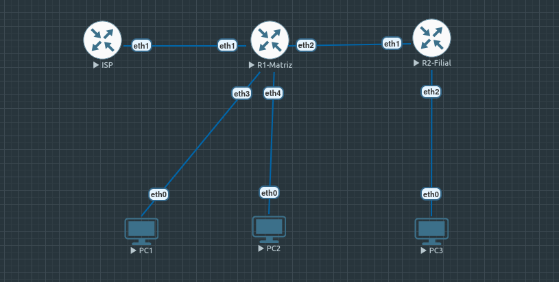

# 🏢 Projeto: Interligação Corporativa Matriz e Filial com MikroTik RouterOS v7

## 🖼️ Topologia do Laboratório

---

## 🎯 Objetivo
Implementação e validação da arquitetura de rede corporativa interligando a Matriz e a Filial utilizando **MikroTik RouterOS v7**, com foco em segregação de tráfego (Layer 2), roteamento dinâmico e distribuição de acesso à internet.

---

## 🛠️ Tecnologias e Implementações

### 1. Camada 2 (Layer 2)
* **Segregação por VLANs:**
  * **VLAN 10:** Setor de TI
  * **VLAN 20:** Setor de Vendas
* **Tecnologia:** *Bridge & VLAN Filtering* no RouterOS.

### 2. Camada 3 (Layer 3) & Serviços
* **Gateways:** Subinterfaces dedicadas para cada segmento de VLAN.
* **Servidores DHCP:** Distribuição automática de IP via processo DORA para as redes locais.
* **Inter-VLAN Routing:** Comunicação controlada entre diferentes segmentos internos.

### 3. Roteamento Dinâmico & Borda
* **Protocolo:** OSPFv2 (Área 0 / Backbone) para anúncio e convergência automática de rotas entre Matriz e Filial.
* **Saída para Internet:** Rota Default (`0.0.0.0/0`) na borda da Matriz com **NAT/Masquerade**.
* **Propagação OSPF:** Distribuição automática da rota padrão para a Filial via `default-originate`.

---

## 🟢 Status do Projeto
* **100% Concluído e Validado** via testes de conectividade de ponta a ponta (ICMP / Ping).

---

## 📥 Como Importar este Laboratório
1. Faça o download do arquivo `Rede Matriz.unl` localizado nesta pasta.
2. Acesse a interface web do seu **EVE-NG**.
3. Clique em **Import** e selecione o arquivo `.unl`.
4. Ligue os roteadores MikroTik e clientes para testar a comunicação entre as pontas.
