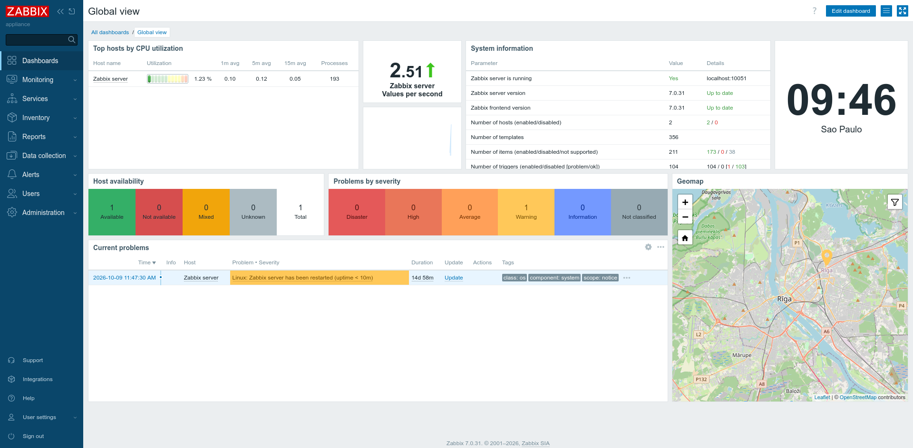

# 📊 Monitorização de Infraestrutura com Zabbix & SNMP

## 🖼️ FOTO DA PAGINA INICIAL

---

## 🎯 Objetivo
Implementação do Zabbix Appliance 7.0 para recolha de métricas e monitorização de ativos via SNMPv2c/SNMPv3 em ambiente simulado no EVE-NG.

---

## 💻 Componentes e Endereçamento IP

| Dispositivo | Função | IP / Interface | Protocolo |
| :--- | :--- | :--- | :--- |
| **Zabbix Server** | Servidor Web / Coletor | `10.1.10.188` | HTTP / SNMP |
| **Cliente Linux** | Agente SNMP | `10.1.10.102` | SNMPd (UDP 161) |

---

## 🛠️ Tecnologias Utilizadas
* **Zabbix Appliance 7.0**
* **Agente de Monitorização SNMP** (SNMPv2c/SNMPv3)
* **Recolha de Métricas:** CPU, Memória, Disco, Interfaces de Rede e Uptime
* **EVE-NG** (Ambiente de Simulação)

---

## 📥 Como Importar no EVE-NG
1. Descarrega o ficheiro `Zabbix.unl` desta pasta.
2. Na interface do EVE-NG, clica em **Import**.
3. Seleciona o ficheiro e inicia os nós no teu ambiente!

