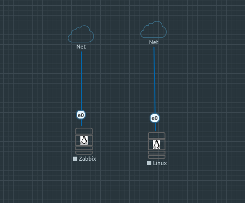

# 📊 Monitorização de Infraestrutura com Zabbix & SNMP

## 🖼️ FOTO TOPOLOGIA

---
## 🖼️ FOTO DA PAGINA INICIA

---

## 🎯 Objetivo
Implementação do Zabbix Appliance 7.0 para recolha de métricas e monitorização de ativos via SNMPv2c/SNMPv3 em ambiente simulado no EVE-NG.

---
## 💻 Componentes e Endereçamento IP

| Nó | Dispositivo / Função | Endereço IP | Interface | MAC Address | Recursos (vCPU / RAM) |
| :--- | :--- | :--- | :--- | :--- | :--- |
| **Zabbix** | Server / Web Appliance 7.0 | `10.1.10.188` | `e0` (pnet0) | `00:50:00:00:01:00` | 2 vCPU / 2048 MB RAM |
| **Linux** | Cliente Agente SNMPd | `10.1.10.102` | `e0` (pnet0) | `00:50:00:00:02:00` | 2 vCPU / 2048 MB RAM |

---

## 🛠️ Tecnologias e Serviços
* **Servidor:** Zabbix Server / Web Appliance 7.0
* **Protocolo de Coleta:** SNMP (Simple Network Management Protocol - Porta UDP 161)
* **Métricas Coletadas:**
  * Uso e carga de **CPU**
  * Consumo de **Memória** e **Disco**
  * Tráfego e estatísticas de **Interfaces de Rede**
  * Tempo de atividade do sistema (**Uptime**)
* **Visualização:** Dashboards personalizados e gestão de Triggers/Alertas.

---

## 🟢 Status do Projeto
* **Availability SNMP:** `GREEN` (Coleta SNMP ativa e totalmente operacional).

---

## 📥 Como Importar este Laboratório
1. Faça o download do arquivo `Zabbix.unl` localizado nesta pasta.
2. Acesse a interface web do seu **EVE-NG**.
3. Clique em **Import** e selecione o arquivo `.unl`.
4. Ligue os nós `Zabbix` e `Linux` e verifique a conectividade de rede na interface `pnet0`.
